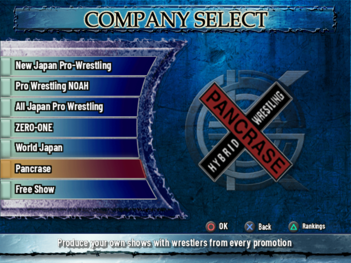
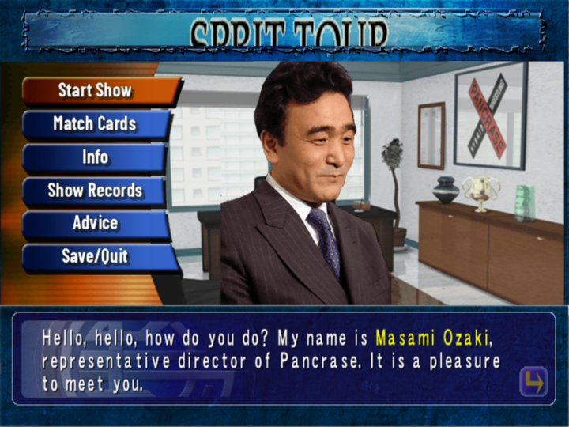
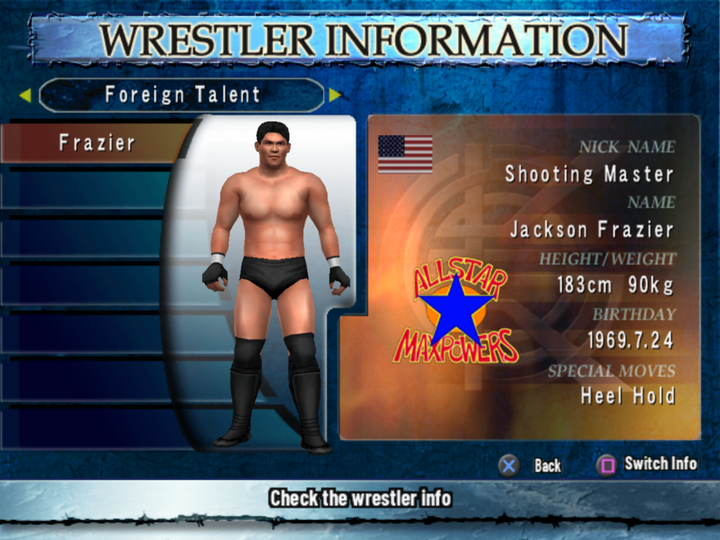
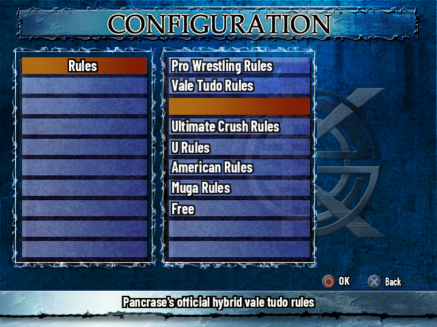
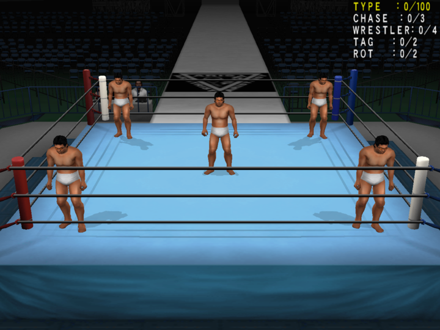

# Hidden content

Unlockables, debug features, button codes and unused content, each marked *verified in game* or
*from the code*. Check The Cutting Room Floor and existing guides first (2026-10-16: nothing
found on any of this; no TCRF page).

Research helpers (not part of the build): build/work/hidden/ - `dump.py` disassembles the ELF,
`annot.py` resolves gp-relative and lui-pair addresses and labels call targets, `fn.py` prints one
function (or windows around a pattern), `roster.py` lists entry 1999's wrestlers with their
unlock flags.

## How unlocking works (*from the code*)
- **Unlock flags**: a byte array at 0x3ef1e8, ids 0-279 (0x118 bytes), read by 0x116910 and
  written by 0x116928; part of the system save (registered by 0x1164d0). Start-up sets 0, 1
  (0x116690), 185 and 186 (0x11a5d0: Brendan Daimos / Brendan Crank are simply always there).
- **Wrestlers**: entry 1999 (WrestlerData) starts with 255 index records of 64 bytes (then 541
  variant blocks of 0x8ed bytes, names at +4); byte +0x10 of the index record is the wrestler's
  unlock flag (0 = always). The select screens ask 0x117da8, which needs the flag in most modes.
  Promotions (entry 2000) have the same kind of flag at +0x27.
- **Secret Shop** (entry 2396, parsed by 0x1bf340 into a heap table): each row's first number is
  its unlock-flag id (60-279). The shop's own state is one byte per row at Survival data +0x55ac+row
  (Survival data = 0x334fe0, 0x385b8 bytes, also in the system save): 0 hidden, 1 for sale, 2
  bought. Entering the shop (0x1bfaf8) puts rows on sale whose requirement is met (the row's
  promotion rank or cleared difficulty). Buying (0x1c96c0) needs souls (Survival data +4; half
  price when +8 is 1), sets 2 and takes the souls. Leaving the shop copies the bought state of a
  few rows to linked rows and then every row's state into its unlock flag (ring rows 265-279 also
  switch the ring on in the Ring option, 0x101498(0xe, n)), and copies wrestler rows to the
  wrestler flags 6-46 (e.g. row 60 Fujinami -> flag 6; colour rows 62, 63, 73-76, 80, 81, 92, 94,
  98, 101 -> variant flags 26-44).
- Linked rows (no price, bought with their parent): 61 Fujinami "Macho" with 60 Fujinami; 69
  Hirata with 68 S.S. Machine; 83-89 Muta "Jason", "Retro" and five Muta hoods with 82 Great
  Muta; 91 with 90 Kokushi Muso; 93 with 92; 96 Hashif Khan's hat with 95; 189 with 188 Curry
  Mask. Edit points = 200 + 50 for each bought "Edit Points +50" row (0x1c9390). Flag 35 (set
  with Kikuchi Super Gen.'s colours) is used by nothing (*from the data*).

## Unlockables
- Secret Shop (Survival Road souls; entry 2396, prices 10-500): 30 hidden wrestlers and colour
  versions, 75 Edit wrestler samples, 42 fighter samples, 13 rings, Edit P+50 x4, SUPER HARD and
  MASTER difficulty, the fighter and S-Stars courses. *From the data*; all shown as bought with
  `--unlocks all` (*verified in game*).
- **Kotetsu Yamamoto** (wrestler 45, flag 13 / shop row 71, not sold): clear the Dojo's last
  course ("Use all you've learned to beat Kotetsu!", course 10) - 0x17ac80 sets flags 13 and 71
  and option (0x18, 9), Kotetsu as referee (*from the code*; the Dojo route is untested, the
  wrestler and the referee show with `--unlocks all`, *verified in game*).

## Password: everything unlocked (*verified in game*, 2026-10-16)
The name entry (0x18a640, run when a name entry is confirmed) compares the entered name with
**小橋蝶野武藤橋本三沢** (Kobashi Chono Muto Hashimoto Misawa, 10 kanji = 20 bytes, which fits the
21-byte given-name field). The check needs game state 1 = 8 and state 0x23 = 1 (0x3ef7e4 words;
state 1 is set to 8 by the menu at 0x150248 for its first two items): Edit Mode -> a wrestler
-> given name, where it was tested. On a match it:
- marks all 84 Dojo lessons cleared (12 courses, table 0x3a8d58; flags at 0x3f1ec8);
- unlocks Kotetsu Yamamoto (as the Dojo does);
- calls **0x100c40, the developers' unlock-all routine** (no other caller): flags 60-278 all set
  and the wrestler/variant flags derived from them, every ring on, every shop row bought, Edit
  points 400, Survival data: 9,999 souls, half price, every promotion's rank 5 and other records
  maxed;
- plays a sound and marks the system data for saving.
Japanese fan sites list it as a nickname code (found 2026-10-29: kakusi.jp, uw.netlify.app,
menokenkou.work); the 2026-10-16 search had missed them. The English build keeps the Japanese
name-entry keyboards with kana-to-kanji conversion (entries 2014/2015), so it can still be typed.
The `all` patch group (docs/PATCHES.md) runs the same routine without the password.

## Content nothing in the game unlocks
- **Wrestler 147** (roster.csv surname Tomoki): a joke wrestler whose nickname and finisher
  reference the publisher; promotion Free, unlock flag 25. Nothing sets flag 25 - not even the
  unlock-all routine - so he never appears. With flag 25 set (`--unlocks all`) he is listed
  under Freelance (Spike Tomoki, 170 cm 68 kg, born 1975.5.23, finisher Spike Crusher) and plays a
  normal match with a plain black-trunks model (*verified in game*, 2026-10-16).
- **Wrestlers 151-154 "Trainee" #1-#4**: flag 24, never set; listed under "Retired" (promotion
  40) with the 100 Edit wrestler slots 155-254 (flag 3). Probably the Dojo's player stand-ins.
  Flag 24 alone shows nothing; with flag 4 too the wrestler select offers a "Retired" group with
  Trainee #1-#4 (170 cm 68 kg, born 1900.0.0, each its own look), all playable (*verified in
  game*, 2026-10-16). `--unlocks all` sets 4, 24 and 25.
- **Promotions 15-17 "謎１/謎２/謎３" (Mystery 1-3)** in entry 2000: flag 2, never set, and no
  wrestler belongs to them; with flag 2 set nothing new appears on the wrestler select (*verified
  in game*). Their records (entries 2000/2017; the Edit-sample copies 2003/2020
  have UNO, S-1 ... in those places) use the Freelance logo (+0x25 = 0x10). The select screen lists
  only promotions with wrestlers (0x116c48 counts them), but Edit Mode builds its promotion list
  from every promotion whose flag is set (0x154580, all 41), so with flag 2 an edit wrestler can
  join Mystery 1-3, and the promotion then appears on the select screen with that wrestler
  (*verified in game*, 2026-10-16; `--unlocks all` sets flag 2). Flag 3 gates the user-made
  content (the 20 "New Promotion" slots 20-39 and the Edit wrestler slots), flag 4 the "Retired"
  group (40). The 謎 "Mystery" name also heads a group of Edit faces: the cut Pancrase fighters
  (next section).
- **Shop rows that are never for sale** (no category, price or requirement, so 0x1bfaf8 never
  offers them; only the unlock-all routine sets their flags): 108 Mask de Panther III, 117, 123,
  134, 138, 142, 143, 149, 153, 158-160, 173, 185-187, 190, 192-195, 214-216, 231-236, 239-251
  (241-251: Monkey, Lion, Leopard, Rider Mask, Samurai, Bird Mask, Alien, Kappa, Bear, Wolf,
  Female Wrestler), 259, 261, 267 (a duplicate "All Japan Retro 2" ring row). Their flags gate
  nothing: the matching Edit heads have flag 0 and are always available under "Original"
  (*from the data*, seen in game). Leftovers of a plan to sell them.

## Cut Pancrase content behind flag 2 (2026-10-16)
Flag 2 (never set by the game; set by `--unlocks all`) gates, besides Mystery 1-3:
- **17 moves** in table 2008 (byte +0xb is a move's unlock flag, read via 0x1191c8; all others 0):
  Northern Lights (602 front clutch, 1058 a second clutch list), Tiger '85 (628 back clutch) and
  Tiger Suplex '85 (1075), Go to Mount (763, face-up), Go to Front Headlock (950, face-down),
  Cyclone Whip Scissors (389, counter), Full Nelson (2855, back clutch), Floor to Apron and Ramp
  to Apron (1761, 1762), four Jog & Look walks (1753, 1754, 1757, 1758), three unnamed "－"
  placeholders (1704, 1886, 1887). The Edit move screen lists them in Clutch Settings, Counter,
  the down-move and entrance lists.
- **284 Edit parts** in table 2010 (u16 unlock flag at +0x1a, getter 0x1192a0): heads of Pancrase
  fighters (Funaki incl. "1994", Minoru Suzuki "hair", Kondo, Y. Takahashi, Kunioku, Shibuya,
  Kengo, Yamamiya, Kikuta, Gono, Sasaki, Hiroto), referees and ring staff (Red Shoes Unno, Tayama,
  Tanaka, Nishinaga, Nakata, Kyohei Wada, Kihara, Abe, Okky Okita, Tiger Hattori), Murota,
  General Bordeaux, Dan Dadahn, Jim Steele "short hair"; Pancrase / GRABAKA T-shirts, tights and
  spats, referee shirts and trousers for every promotion, the President's suit, Ebosu suits,
  tattoos, boots, entrance gowns (Baba, Funaki, Minoru, Chono T2000, Tenzan, Koshinaka ...);
  entrance-announcer lines for the Pancrase fighters and the title-match introductions.
No wrestler record belongs to Pancrase: its roster was removed and its parts left behind flag 2
(the Pancrase name stays in course list 2400 and as Match Maker slot 6 - next section). Two more locks hide
the parts even with the flag: their body-type mask (u16 +8, 0x156e28 lists a part only if the
edited wrestler's type bit is set) is 0 for 191 of them, and the face screen never lists face
header 5, "Mystery" (0x157780 `beq s1, 5` in 0x157738), where the 13 Pancrase faces are filed.
With all three lifted (`--unlocks all`) the Mystery faces, referee faces, Jim Steele "Short",
Funaki/Kondo shirts and spats and both extra clutch moves (Northern Lights, Tiger '85) appear and
work (*verified in game*, 2026-10-16).

## Pancrase in the modes: cut, data left behind (2026-10-16)
The game was built with Pancrase as a playable promotion; its roster was removed late and the
modes were blocked with hard-coded skips rather than having their data deleted.

**Match Maker** (*verified in game* with a test patch). The company list (0x1d3680, called from
the select screen 0x1d38b0) loops slots 0-7 and always skips slot 6 (0x1d36a0 `addiu s3, zero, 6`
and `beql s1, s3` at 0x1d36b0); slot 7, the Free Show, needs slots 1-5 cleared. Setting s3 to -1
(0x1d36a0: 0x24130006 -> 0x2413ffff) lists Pancrase, and its scenario is complete: the Pancrase
logo, an office scene with president Masami Ozaki and his dialogue, the shows SPRIT TOUR, HYBRID
TOUR, DARK2004 and a 10th-anniversary show "Find Pancrase's strongest!" (entry 2811, all under
Pancrase Rules, King of Pancrase title matches allowed), briefings, verdicts and advice
(2853+6 ...), and King of Pancrase title holders (2835). It cannot be played: its team list (2803)
lacks the home roster line every other promotion's list starts with, so the first show offers
only Jackson Frazier (Foreign Talent) and U-FILE CAMP's Kiyoshi Tamura, too few for a card. Of
the title holders only Josh Barnett still exists; "Takahashi" now finds Fuyuki Takahashi instead
of the cut Yoshiki Takahashi. Not restored (user decision, 2026-10-16).

| Team list 2803 (Pancrase) | wrestlers per show 1-4 |
|---|---|
| Foreign Talent (来日外国人) | 1, 1, 3, 4 |
| Freelance | 0, 0, 0, 8 |
| U-FILE CAMP.COM | 2, 2, 4, 5 |
| New Japan | 0, 0, 3, 0 |

**Survival Road** (*verified in game* with a test patch). The course list (0x1c2ed0) marks course
6, Pancrase, as skipped (`movz s2, fp, v0` at 0x1c2f94, v0 = course xor 6); the entry 2400 course
list and the singles settings sheet 2409 (Pancrase Rules, ring and fans, referee Tiger Hattori)
exist. With the `movz` replaced by `nop` the course can be started: it plays the Survival Road
intro movie and then goes no further: the opponent tables 2012/2013 have no course-6 entries, so the
draw divides by a pool of 0 (`div` + `break 7` at 0x1bf174, *from the code*). Not restored.

**Not in the other modes** (*from the data*): the all-belts list 2836 has no King of Pancrase
belts (they appear only in the title history text and Match Maker), and the Elimination teams
(2001) have no Pancrase team.

## The developers' camera test viewer (*verified in game*, 2026-10-16)
0x286108-0x286fcc (3,784 bytes), with no caller and no pointer: a self-contained test screen for
the broadcast camera. It sets up the ring with five bare placeholder wrestlers (match setup
0x1128f8, 0x112430, 0x112f38; positions through 0x108ce8 / 0x108d38), runs its own loop and draws
a menu with the game's text routine (0x1b1410, "%s: %d/%d", strings at 0x3d6d18).
- D-pad up/down picks a line, left/right changes it; every change re-applies the camera (0x2851b0).
- TYPE 0-99 (shown as /100): the camera program; 0 = none. 1-99 frame the wrestler set by
  WRESTLER using follow mode CHASE (0-2); 100 and up would run 0x281008 instead. TAG and ROT 0/1.
- × stops the camera program (0x2853c8). △ selects one of the wrestlers, which the stick then
  moves around the ring (no animation - they only slide). SELECT (pad bit 0x100) leaves.
In game: the camera follows the chosen wrestler with the chosen chase mode; the wrestlers can be
moved anywhere; nothing animates. Developer group `debugview` (`--unlocks all,debugview`; not
in releases) runs it before the
last title-menu item (jump table 0x3a8fd0 entry 8 -> a stub in the unreferenced printer
0x1978f0), which opens normally after SELECT. Nothing else in the dead-code scan is a feature
(small physics, effect and UI helpers; a second save-block unpacker 0x118730; the
"SOUND_BGM_ID = %d" printer 0x1978f0).

## Option values the game never shows
Every option value (rules, rings, crowds, referees ...) has a state byte at 0x3e9a5e + table
0x3a50f0[category] + item (0 shown, 1 locked until the shop/Dojo unlocks it, 3 never shown; the
lists count only 0 - 0x101500). Defaults by 0x101230 (system save block 0x3e9a5c). Their names
are label pictures on a fixed grid (000_01516 rules, 01517 rings and crowds, 01518 venues and
people); the executable's Match Maker key lists (elf.txt 0x2ae7b8-0x2aec10) name every value in
menu order. Set to 3 and never cleared, all *verified in game* (2026-10-16) with `--unlocks all`:
- rule 2 **Pancrase Rules** (help line "Pancrase's official hybrid vale tudo rules"; works);
- ring 13 **Pancrase** and ring 16 **WAR** (both load in a match; no preview picture on disc);
- crowd 5 **Pancrase Fans**; referee 8 **Soichi Hiroto** (no portrait on disc);
- rule 8: an empty slot - selecting it sets no rule; stays hidden;
- round counts 5, 6, 8, 10, 12, 13 (0x20-0x28): disallowed values, left hidden.
Their label slots were empty; the translation draws the names in (graphics.csv). Referee 9,
Kotetsu Yamamoto (state 1), is only unlocked by the Dojo or the password - not by 0x100c40;
`--unlocks all` shows it too (*verified in game*).

## Searched and not found (2026-10-16)
- Modes: the title menu's 9 entries (0x125540, jump table 0x3a8fd0) are all reachable; screen ids
  2-6 of the main dispatch (0x1220e0, table 0x3a8d90) have no handler.
- Debug: the print routine 0x119510 is an empty stub; 0x1978f0 ("SOUND_BGM_ID = %d") has no caller;
  no debug/test strings. Pictures 2033-2040: no code loads them (orphaned).
- Button codes: every pad check uses single-button masks (mask 0x2, probably R2, scrolls lists
  faster); no sequences.
- Wrestlers: all 541 variant blocks are used; variant block byte +3 is the variant's unlock flag
  (0, 3, 6-46); no wrestler in promotions 15-17 or 20-39. Edit templates (1452, u16 flag at
  +0x7c, getter 0x170c40) are all reachable. The never-sold shop rows gate nothing: their heads
  (animals, Female Wrestler, Delta, Haiti, Shiroki ...) have flag 0 and are always in Edit.
- Unlock flags 5 and 23: nothing reads them (no constant call, no direct load, no table value).
- Movies: KC2Opening and KachinukiOP (the Survival Road opening) play; movtop.sfd is a 16 KB
  stub (one stream header, then padding).
- Move spreadsheet 2029: names differ from the game tables mostly by spelling; no cut moves shown.

## Leads
- Debug display pictures in KC2FIRE.000 (*from the data*): 000_02033, 02035-02038 a match-state
  readout in a tiny pixel font, 000_02040 a list of commentary categories, 000_02034 OFF/ON in
  the same font. Kept untranslated (graphics.csv); no code loads them (above).
- Leftover source files in KC2FIRE.000 (*from the code*: never loaded): 2029 a move/action
  spreadsheet (TSV), 2030 the script of every voice clip in KC2FIRE.AFS (ids = AFS names, in AFS
  order), 2031 the C header of AFS file ids. 2030 transcribes all the spoken commentary and could
  serve a future subtitle or notes extra. The debug commentary-category list (000_02040) is not
  built from them. The sheets 2403-2422 (Survival Road courses) and 2813-2844 (Match Maker) are
  real data (docs/TECHNICAL.md).
