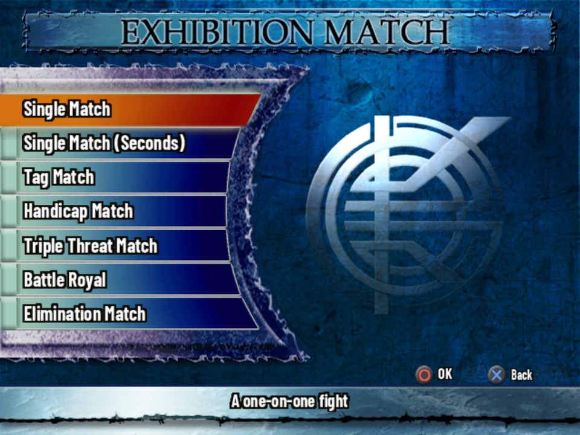
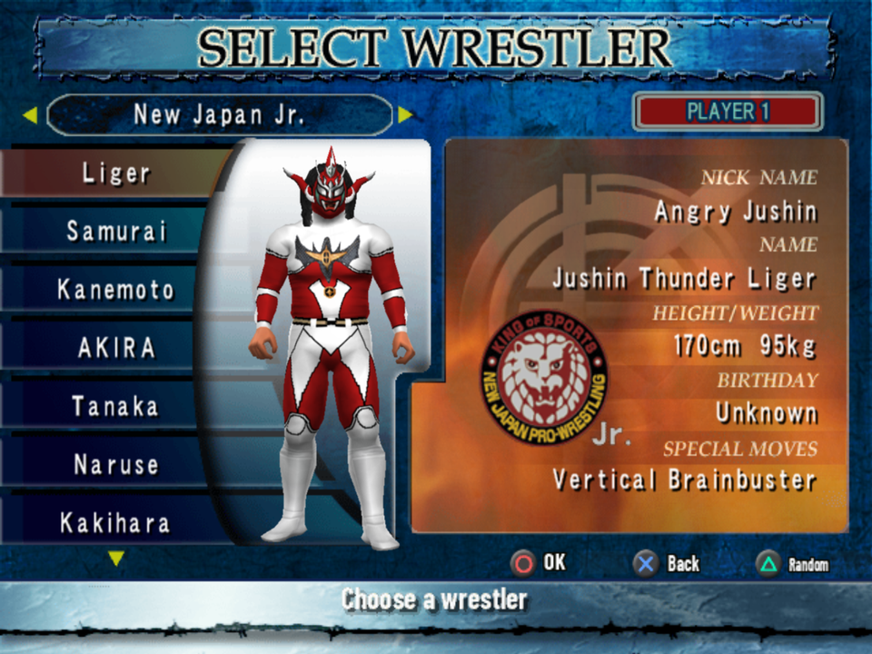
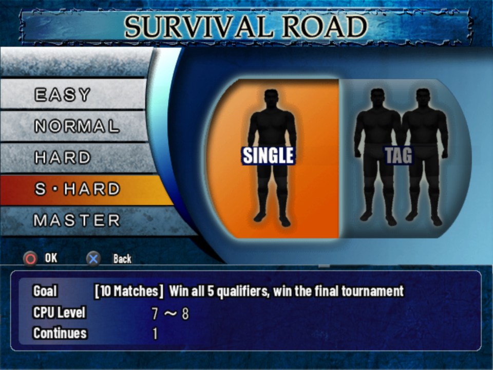
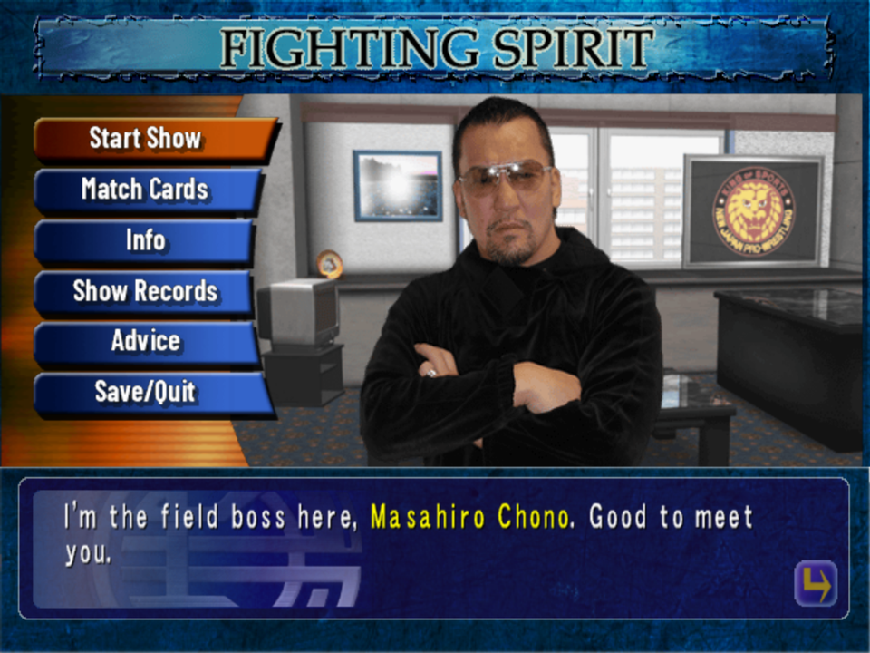
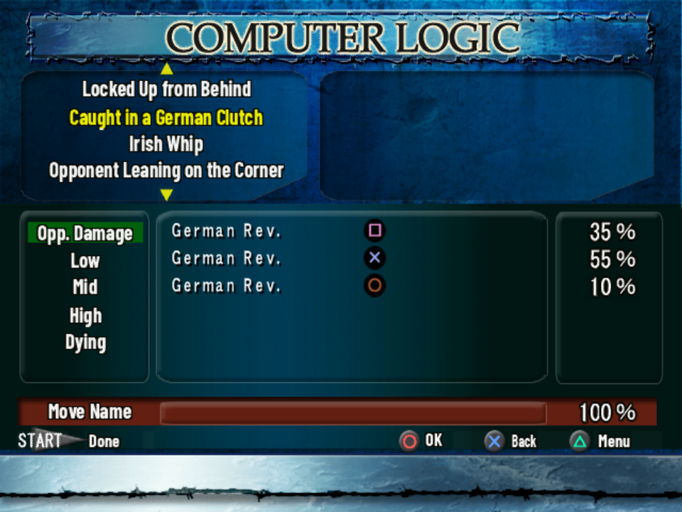
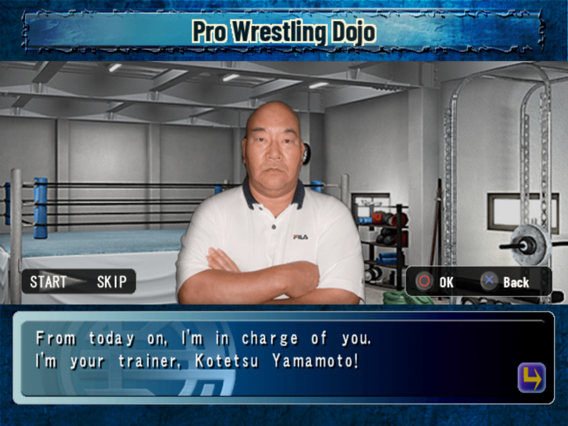

# Screenshots

King of Colosseum II with the English patch, taken in PCSX2.

## Exhibition Match

The menu labels and the screen title are redrawn images; the help line at the bottom is regular
menu text.

## Wrestler select

Names, nicknames and finishers use the official English spellings. The promotion logos stay as
they are, since they're artwork.

## Survival Road

## Match Maker

The briefings keep the original's highlighting: names in yellow, as in the Japanese.

## Computer Logic

Situations and moves from the CPU logic editor in Edit Mode.

## Pro Wrestling Dojo

The trainers' dialogue and all 84 lessons are in English.
